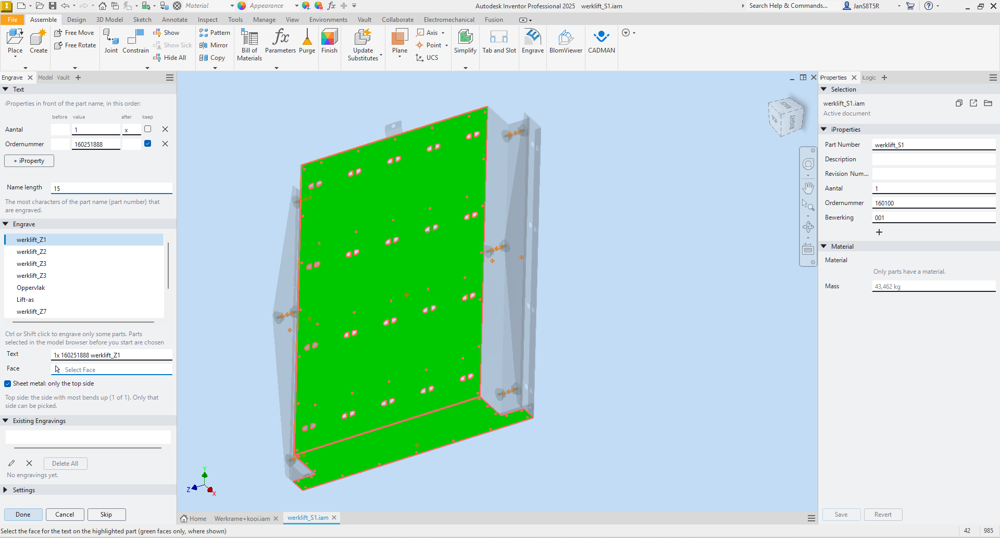
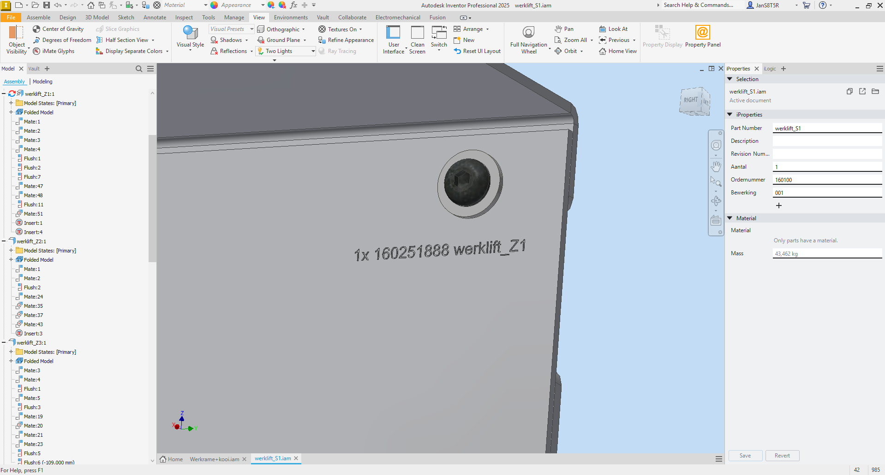
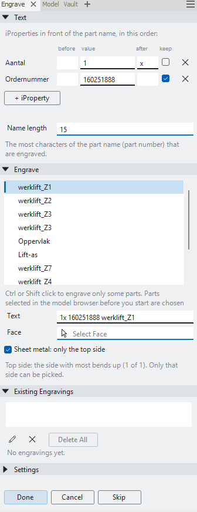

# Inventor Engrave

Small Autodesk Inventor add-in that engraves the part number, optionally after the value of an iProperty (such as an
order number), into parts. It walks through the parts of an assembly, the sheets of a drawing, or works on the open
part. For sheet metal it shows which side is the top. The text is placed as a sketch where you click. You drag or turn
it in Inventor's sketch environment, and it is then engraved with Inventor's Emboss (Engrave from Face). The panel is
built in Inventor's own style and follows your theme, like the Tab and Slot add-in.







## Install

Download `Engrave-Setup-<version>.exe` from [Releases](https://github.com/JanTrueno/Inventor-Engrave/releases), close
Inventor and run it. It installs per user (no admin rights); uninstall via Windows Settings → Apps.

## Features

- **Assembly**: every visible part is listed once, also when it is used several times (the engraving is in the part
  file): sheet metal, tubes, profiles, any part. Sheet metal parts come first. Hidden and suppressed parts are left
  out, and so are standard Content Center parts (bolts, nuts). A read-only part (checked in) is listed as such. Click any part in the list to go on from there, or **Skip** to the next one. To engrave only some parts, Ctrl or
  Shift click them in the list, or select them (or a subassembly) in the model browser before you click Engrave:
  Skip and the next part then only go through those, and a bar marks the part being engraved now. A checkmark
  shows which parts are engraved: bright for this run, dim for earlier. While you work, every other part is
  see-through, so the part being engraved stands out; they are solid again when you finish or cancel.
- **Drawing**: every sheet is one row, for the part in its first view. That part opens in its own window to pick the
  face; the windows are closed again at the end. The text is built the same way as elsewhere (iProperties, read from
  each part, and the part name), with ` - sheet number` after it unless you untick **Add the sheet number**. All
  sheets are listed in order; for a range, Shift click the first and the last sheet, or select their views before
  you start.
- **Top side found for you** (sheet metal): the side with the inside of most bends ("bends up") is shown in green and
  only those faces can be picked. Untick **Sheet metal: only the top side** to pick any face, for example every side
  of a square tube made as sheet metal. If the sides cannot be told apart, every face can be picked. A setting turns this
  around if your CAM software sees the other side as the top.
- **Tubes and round faces**: on a round face (a round tube) the sketch goes on a work plane touching the face where
  you click, and the text is wrapped onto the face (Emboss, Wrap to Face). On parts that are not sheet metal, such as
  square tubes and profiles, every flat and round face can be picked.
- **Your own text**: the part number, cut off after a number of characters you set (**Name length**, 20 by default).
  **+ iProperty** adds iProperties whose values go in front of it, in the order you add them (for example
  `ordernummer`). Pick them like in the iProperty Manager: Summary, Project, Status, or Custom with the custom
  iProperties of the open document and their values, or type any name. Each has its own value field, a small
  **before** and **after** field for text around the value (for example `X` after `Aantal`, giving `5X`), and a
  remove button. The values are read from each part itself; a part without that iProperty uses the value of the
  open assembly or drawing. The fields show the values of the part being engraved, and a value you type there is
  used for that part only. Tick **keep** to use the value you fill in once for every part instead (the tick is
  remembered). A **Placeholder** value in the settings (for example `160100`) means "not filled in yet" and is refused.
  You can still change the text per part before you click a face.
- **Place it yourself**: the text starts where you click, along the longest straight edge and readable from your view.
  Drag it or turn it (Sketch → Rotate), then **Finish Sketch** in Inventor or in the panel. **Cancel** while
  sketching drops that text only. Inventor's **Return** does no harm: it finishes the sketch like Finish Sketch,
  and picking simply carries on.
- **Existing engravings**: listed with their text. **Edit** opens the text sketch to move or change the text,
  **Delete** removes one engraving, **Delete All** removes them all.
- **Cancel**: closes the panel and puts every part back as it was when you started. Until you click **Done**, a
  replaced or deleted engraving is kept aside in the part (suppressed, named `Graveer (old)`), so Cancel can bring it
  back; Done removes it.
- **Safe depth**: 0.5 mm by default, never more than a quarter of the thickness for sheet metal.
- Nothing is saved for you.

## Requirements

- Windows with Autodesk Inventor 2025 (the add-in runs on .NET 8)
- [.NET 8 SDK](https://dotnet.microsoft.com/download/dotnet/8.0) to build it

## Building

The project references `Autodesk.Inventor.Interop.dll` from the Inventor installation at
`C:\Program Files\Autodesk\Inventor 2025\Bin\Public Assemblies`. If Inventor is installed somewhere else, change the
`HintPath` in `Engrave.csproj` to match.

```powershell
git clone https://github.com/JanTrueno/Inventor-Engrave.git
cd Inventor-Engrave
dotnet build Engrave.csproj -c Release
```

The output goes to `bin\Release\net8.0-windows\`: `Engrave.dll`, `.pdb` and `.deps.json`.

## Install from source

Close Inventor (it locks the add-in DLL while running), then run:

```powershell
powershell -ExecutionPolicy Bypass -File install.ps1
```

This builds the add-in and installs it as an app bundle in `%APPDATA%\Autodesk\ApplicationPlugins\Engrave.bundle`.

- `install.ps1 -SkipBuild` installs the last build without building again.
- `install.ps1 -Remove` uninstalls it.

To build the installer (`dist\Engrave-Setup-<version>.exe`, needs [Inno Setup 6](https://jrsoftware.org/isinfo.php)):

```powershell
powershell -ExecutionPolicy Bypass -File build-installer.ps1
```

## Usage

1. Click **Engrave**: on the **Assemble** tab of an assembly, the **Sheet Metal** or **3D Model** tab of a part, or
   the **Place Views** tab of a drawing.
2. Optionally add iProperties with **+ iProperty**. They are remembered.
3. The first part is highlighted in orange (for sheet metal, the top side in green). Click the face for the text.
4. Drag the text into place, turn it if needed, and click **Finish Sketch**. It is engraved and the next part is up.
5. Click **Done** when you are finished, and save. **Cancel** puts everything back.

The settings are kept in `%APPDATA%\Engrave\settings.json`. A log is written to `%LOCALAPPDATA%\Engrave\log.txt`.

## License

GPL-3.0, see [LICENSE](LICENSE). The section chevrons and list icons come from Autodesk Weave (Apache-2.0), see
[THIRD-PARTY-NOTICES.txt](THIRD-PARTY-NOTICES.txt).
